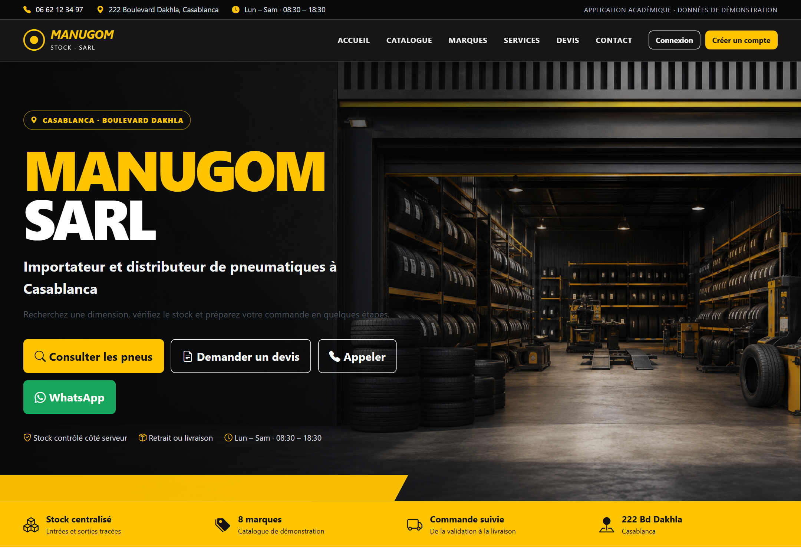

# MANUGOM Stock

Application web de gestion de pneus, de commandes clients et d'approvisionnements, réalisée par Youssef Bouikourar avec Django et SQLite.

Le projet comprend un catalogue public, un espace client et un espace de gestion pour les employés et l'administrateur. Les références, prix, stocks et comptes livrés avec le projet servent à la démonstration.



## Lancer le projet

Depuis PowerShell, dans le dossier du projet :

```powershell
python -m venv .venv
.\.venv\Scripts\Activate.ps1
python -m pip install -r requirements.txt
python manage.py migrate
python manage.py seed_demo
python manage.py runserver
```

Le site est accessible sur [http://127.0.0.1:8000/](http://127.0.0.1:8000/). L'administration Django se trouve sur [http://127.0.0.1:8000/django-admin/](http://127.0.0.1:8000/django-admin/).

## Comptes de démonstration

| Rôle | Identifiant | Mot de passe |
|---|---|---|
| Administrateur | `admin` | `Admin@2026!` |
| Employé | `employe1` ou `employe2` | `Employe@2026!` |
| Client | `client1` à `client10` | `Client@2026!` |

Ces comptes sont destinés aux essais locaux. Remplacez-les avant une utilisation réelle.

## Fonctionnement

Le visiteur peut rechercher un pneu par dimension, marque, catégorie, saison ou prix, consulter sa disponibilité et demander un devis. Après connexion, le client dispose d'un panier persistant et suit ses propres commandes.

L'employé gère le catalogue, les clients, les fournisseurs et les approvisionnements. Le tableau de bord présente les ventes, la valeur du stock, les références à réapprovisionner et les mouvements récents. L'administrateur gère également les comptes et les accès.

Une commande reste en attente jusqu'à sa confirmation par le magasin. La confirmation vérifie les quantités et enregistre les sorties de stock. Une annulation autorisée restaure les quantités une seule fois. La réception d'un approvisionnement ajoute les entrées et bloque une seconde réception. Chaque mouvement conserve son auteur, son origine et les quantités avant et après l'opération.

## Organisation du code

| Application | Responsabilité |
|---|---|
| `accounts` | Comptes, connexion, inscription et rôles |
| `inventory` | Pneus, marques, catégories et mouvements de stock |
| `customers` | Fiches clients |
| `orders` | Paniers, commandes et lignes historiques |
| `suppliers` | Fournisseurs et approvisionnements |
| `dashboard` | Gestion et indicateurs |
| `quotes` | Devis et messages de contact |
| `core` | Pages publiques et jeu de démonstration |

Les services `ServiceCommande`, `ServiceStock` et `ServiceApprovisionnement` regroupent les règles métier et les transactions. Les vues traitent les requêtes, valident les formulaires et contrôlent les accès.

## Rapport et diagrammes

- [Rapport PDF](output/pdf/Rapport_MANUGOM_Stock.pdf)
- [Rapport Word modifiable](output/docx/Rapport_MANUGOM_Stock.docx)
- [Diagramme de cas d'utilisation](docs/uml/final/cas-utilisation-global.svg)
- [Ensemble des diagrammes UML](docs/uml/final/)
- [Modèle et dictionnaire des données](docs/database/)

Dans le diagramme public, le visiteur et le client spécialisent l'acteur « Utilisateur du site ». Ils partagent la consultation du catalogue et le contact avec le magasin ; la création de compte appartient uniquement au visiteur non connecté.

Les sources et les commandes de génération sont décrites dans [la documentation UML](docs/uml/README.md).

## Vérifications

```powershell
python manage.py check
python manage.py makemigrations --check --dry-run
python manage.py test
```

La suite comprend 34 tests de modèles, de services, de permissions et de parcours web. Elle vérifie les transitions de commandes, les sorties et retours de stock, la réception des approvisionnements et l'isolation des commandes par client.

## Limites

La configuration fournie sert au développement local. SQLite simplifie l'installation, mais n'est pas adapté à une forte concurrence d'écriture. Le paiement et la livraison sont suivis par des états métier ; aucun prestataire externe n'est connecté. Les courriels sont écrits dans la console et les boutons Appeler et WhatsApp ouvrent respectivement un lien `tel:` et `wa.me`.

Les deux visuels de démonstration du showroom et du pneu ont été générés ; leur provenance est conservée dans [le journal de réalisation](docs/rapport/journal-realisation.md).
